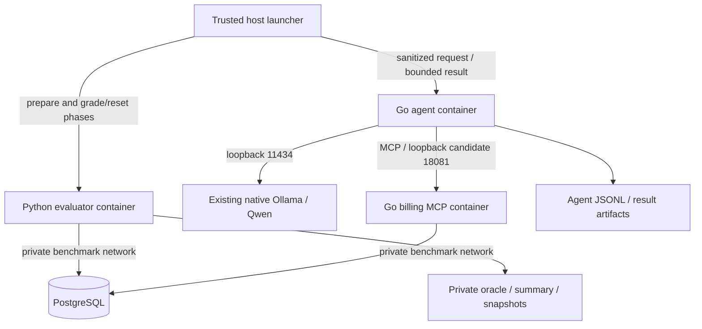

# MCPBench v1 architecture

Status: reviewed-design candidate for documentation task T003, not an implemented
or runtime-validated system. The [shared assumptions](WAVE1_CONTRACT_ASSUMPTIONS.md)
govern this wave; T006 freezes versioned schemas and exact launch/auth transport.

## Components and trust boundaries

Python owns evaluation policy: prepare/reset state, define the expected outcome,
interpret agent completion and grade the database. A trusted host-side launcher
provides process transport and starts only predeclared benchmark commands. It
sequences evaluator prepare → agent execute → evaluator grade/reset, records exit
status and enforces process deadlines. Even after a crash, it invokes the bounded
settlement/evidence lifecycle below; uncertain active writes require quarantine
instead of grading an unsettled state or blindly cleaning up.
The launcher is not an agent tool. Only this trusted control plane may use the host
container runtime; no container receives its Docker socket or privileged mode.

Use a bounded versioned JSON request/result protocol over run-specific files or
stdin/stdout. The agent receives only sanitized task/configuration and run-scoped
synthetic authorization/routing metadata. Mount only its request, event and result
paths; exclude expected-state fixtures, evaluator secrets, database credentials,
oracle snapshots and parent artifact directories. A model-facing prompt never
contains the trusted auth envelope. Agent output is untrusted until validated;
missing/malformed output is a recorded failure, not permission to skip grading.
T006 specifies field schemas, size limits and launcher argument/environment
allowlists before implementation.

## Deployment and connectivity

Propose a dedicated Compose project `mcpbench`, with names/subnets/ports checked
unused before startup. MCP and Python evaluator join the project-scoped internal
DB network. PostgreSQL has a project-owned data volume and **no host publication**.
MCP listens on container port 8080 and publishes only `127.0.0.1:18081`; this is a
candidate port, not a verified free one. Preserve all existing networks/volumes.

The Go agent uses Linux host networking to call native Ollama at loopback 11434
and MCP at loopback 18081 without rebinding Ollama. It opens no listener, has no
published ports and has no DB access credentials. The Python evaluator stays on
the private DB network; it does not call Ollama or route database operations through
the agent. This separation avoids giving a model process grader privileges merely
to simplify orchestration.

Host networking reduces agent network isolation: endpoint allowlists in trusted
application code are not OS-level egress enforcement. Use fixed configured API
endpoints, no shell/arbitrary URL tool, non-root execution, dropped capabilities,
`no-new-privileges` and read-only container filesystems except narrow writable
result/temp paths. Treat tool output as data. A stricter relay/egress design may
be considered later, but adds a component and policy to validate. Bridge container
`localhost` is not the host; a host-gateway mapping alone cannot reach a service
bound exclusively to host loopback.

The agent/evaluator are explicit one-shot profiles, with serial attempts in v1.
MCP/DB have bounded health checks; readiness requires the expected schema and seed,
not just an open socket. Native Ollama is outside Compose and is never restarted
by dependency handling. Initially avoid restart loops that conceal failures.

## Evaluation-first seams and data lifecycle

Use a Go module for `cmd/billing-mcp`, `cmd/agent`, billing/store, MCP and Ollama
packages. Python evaluation lives under `eval/` with fixture, grading, reset and
runner modules; SQL migrations/seeds live under `db/`. These are planned paths.
The independent Python oracle and adversarial expected-state tests precede billing
implementation. Pin Go/Python dependencies, MCP SDK/protocol and images when the
relevant admitted implementation tasks run; no versions are selected by this prose.

Each attempt has a distinct run ID and benchmark-owned database/schema with a
canonical seed fingerprint. The evaluator prepares it and verifies the fingerprint
before agent execution. The server maps trusted tenant/run context to that isolated
state; never interpolate a model-provided database/schema name. Server-side
principal/run validation is mandatory on every call. T006 must define the trusted
authentication and registered run-mapping mechanism, rejecting tampered/unknown
bindings; trusting arbitrary client headers is insufficient.

Terminal-state ordering is part of correctness, not merely cleanup:

1. At agent result/deadline, preserve output/events/exit status, revoke agent
   execution capability and prevent new agent calls. Process exit alone does not
   prove that an already-authorized MCP write has settled.
2. Establish boundedly that all such operations completed or rolled back and
   cannot commit later. T006 specifies the actual fence/drain protocol. If this
   cannot be established, record `settlement_unknown`, fail smoke/comparison
   validity, retain diagnostic evidence and quarantine the run. A diagnostic
   snapshot is not authoritative PASS; do not reset/reuse potentially live state.
3. Save an immutable **agent-only settled snapshot**, then grade original database
   state and the original agent answer. Preserve that verdict before any verifier
   call; a replay must never create a missing draft or rescue a failed attempt.
4. Only after the original state/answer pass, issue a separate trusted verifier
   capability, invisible to the agent and constrained to that settled run/request.
   Perform same-key/same-payload replay and changed-payload conflict checks. Assert
   the same invoice ID and no application-state changes. Agent access stays revoked.
5. Revoke verifier access, settle/drain again and save a **final settled snapshot**.
   Compare its application state with the agent-only snapshot and grade replay and
   no-extra-write invariants. Late changes or unknown settlement fail verification;
   they do not overwrite original correctness evidence. Correct task state can
   therefore coexist with failed verification or invalid comparison evidence.
6. Persist all evidence, then perform scoped reset and verify the seed fingerprint.
   Unknown active writes require quarantine rather than a risky reset. Revoke all
   execution capabilities before storage reuse.

Failed initial reset blocks execution; failed final reset marks cleanup failure
and prevents reuse. Artifacts persist outside reset scope. No global database
reset, shared-volume deletion or homelab cleanup is part of this lifecycle.

## MCP and model loop

Use a maintained MCP SDK with actual initialization/capability negotiation,
`tools/list` and `tools/call` over Streamable HTTP `/mcp`. Validate Host/Origin,
negotiated lifecycle, argument schemas, bounded payloads and tool errors. A REST
endpoint merely named MCP is insufficient. Server ACLs are independent of the
agent's exposed schemas: billing-reader may read, billing-drafter may read/create
a draft, and neither may send/pay or cross tenant/run boundaries.

The Go agent translates authorized MCP schemas to native Ollama function tools,
validates returned names/JSON before dispatch, preserves call/result correlation
and appends assistant calls/tool results to chat history. Use native `/api/chat`
with `stream:false`. Verify the exact installed tag/digest, capabilities and
residency; do not infer support from “Qwen 3.5 9B” or client version alone.

T040 is a future one-request harmless `probe_echo` capability test after T007 and
separate approval, without a billing server or writes. Strict returned-name/argument
validation and local echo computation establish observed basic tool output only.
T023 later proves a real invoice through MCP and the independent DB oracle.
Scripted replies validate loop mechanics but never stand in for live-model success.

## Synthetic billing and baseline catalog

One fictional tenant, USD only, integer quantities and cents. Seed active CUST-001
(Example Studio) and SVC-CONSULT (Consulting, 12,500 cents/hour), plus clearly named
decoys. The exact smoke oracle is in [PROJECT_CONTEXT.md](PROJECT_CONTEXT.md).

| Smoke tool | Model-facing input | Server behavior |
| --- | --- | --- |
| `billing_list_customers` | Empty object | Authorized synthetic IDs/names, stable bounded order |
| `billing_list_items` | Empty object | Authorized IDs/descriptions, units and canonical USD prices |
| `billing_create_draft_invoice` | Customer ID, invoice/due dates, 1–10 lines of item ID and integer quantity 1–1000 | Validate active IDs/dates/currency/unknown fields; persist one draft and canonical lines/totals atomically |

Inject idempotency metadata through trusted launcher/agent transport, outside
model arguments. Scope the key to tenant/run; enforce unique atomic persistence
and a normalized payload fingerprint. Same key/payload returns the existing draft;
a changed payload conflicts. Read canonical prices within the transaction and
check arithmetic bounds; validation failure leaves no partial rows. No tax,
discounts, payment or send capability exists in the first slice.

After T023, extend to ten executable tools with seven reads:
`billing_get_customer`, `billing_list_projects`, `billing_get_project`,
`billing_list_timesheets`, `billing_get_timesheet`, `billing_list_invoices`,
`billing_get_invoice`. Add fictional projects/timesheets and meaningful queries;
these are not schema-only placeholders. T006 defines their precise pagination,
filters, error/output and authorization contracts before T024 implements them.

Use versioned migrations for customers, items, projects, timesheets, draft headers,
lines and run/idempotency metadata. Repeated seeds are stable; image initialization
scripts alone cannot migrate an existing volume. Store only synthetic DB secrets
in ignored control-plane configuration, never prompts, fixtures or logs.

## V1 logs, artifacts and budgets

V1 uses structured JSONL events correlated by run ID, model/tool call ID and stage,
with UTC timestamps, monotonic durations, hashes and explicit outcomes. Python
persists manifests, expected-state references, DB snapshots and summary verdicts;
the agent sees only its narrow artifact paths. Missing counts are null, failed
attempts remain in denominators and incomplete logging is explicit. JSONL is
sufficient to validate attribution and replay analysis before extra telemetry
infrastructure. OpenTelemetry, Jaeger and collectors are deferred to v2.

| Component | Proposed initial bound or assumption |
| --- | --- |
| PostgreSQL | 512 MiB, 0.5 CPU, pool up to 5 connections |
| Go MCP server | 256 MiB, 0.5 CPU |
| Go agent | 512 MiB, 1 CPU; one task at a time |
| Python evaluator | 512 MiB, 0.5 CPU; serial phases |
| Native model | Estimate 8–12 GiB RAM until quantization/context measured |
| Admission/reserve | At least 20 GiB available before trial; keep 8 GiB available while running |
| Storage | At least 20 GiB free on relevant filesystems; 100 MiB smoke artifact cap |

These are design assumptions, not measured capacity. Native Ollama is outside
Compose limits. Apply [IMPLEMENTATION_PLAN.md](IMPLEMENTATION_PLAN.md) admission
and abort rules, including the 60-second sample and fresh host health/loading
checks; current access blockers mean the gate has not passed.

Request-local defaults, if supported: context 4096, output 512, temperature zero,
recorded seed/thinking/keep-alive. Never silently truncate schemas or change global
Ollama settings. Maximum 8 model turns, 12 tool calls, 5-second DB/tool deadlines,
120 seconds/model request and 300 seconds/task; at most one transient retry within
the same total budget. Preserve the key for uncertain write outcomes. Slow CPU
inference may time out; record that outcome instead of extending comparison budgets.

Post-agent settlement and verification have a separate maximum of 30 seconds
total, including at most 5 seconds per settlement, verification or DB operation,
at most two verifier calls and no verifier retries. This sits outside the
300-second agent deadline and cannot extend it or rescue a timeout. Record and
charge these costs separately in full lifecycle latency/compute for every
strategy. Budget exhaustion with uncertain writes follows the quarantine rule;
T006 freezes exact fencing, capability constraints and failure schemas.

A resource/health abort stops only owned benchmark execution, records interruption
and preserves evidence. Cancellation may not release native model memory promptly;
observe rather than force unloading. Existing services, drivers, volumes and
native Ollama configuration remain untouched. No runtime implementation is
approved by completing these documents.
