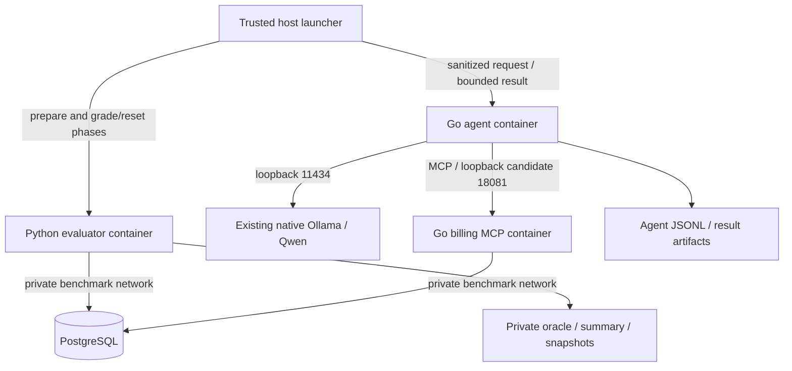

# MCPBench v1 architecture

Implementation status: the T006 static contract bundle is now approved under
contracts/. Runtime components described here are still planned, not proven. T008 now pins
Go/Python/SDK/protocol and image identities in [DEPENDENCIES.md](DEPENDENCIES.md);
its package boundaries compile and commands fail closed, with no billing runtime.
The active goal authorizes routine eligible DAG work; no admission/security gate
is waived. Older documentation-wave authorization limits below are historical.

Status: design candidate for T003's permission-refresh documentation wave, not an
implemented or runtime-validated system. The [shared assumptions](WAVE1_CONTRACT_ASSUMPTIONS.md)
govern this wave; T006 freezes versioned schemas and exact launch/auth transport.
Recorded host/API metadata is distinguished from proposed deployment below.

## Components and trust boundaries

Python owns evaluation policy: prepare/reset state, define the expected outcome,
interpret agent completion and grade the database. A trusted host-side launcher
provides process transport and starts only predeclared benchmark commands. It
sequences evaluator prepare → agent execute → evaluator grade/reset, records exit
status and enforces process deadlines. Even after a crash, it invokes the bounded
settlement/evidence lifecycle below; uncertain active writes require quarantine
instead of grading an unsettled state or blindly cleaning up.
The launcher is not an agent tool. Only this trusted control plane may use the host
container runtime; no container receives its Docker socket or privileged mode.

Use a bounded versioned JSON request/result protocol over run-specific files or
stdin/stdout. The agent receives only sanitized task/configuration and run-scoped
synthetic authorization/routing metadata. Mount only its request, event and result
paths; exclude expected-state fixtures, evaluator secrets, database credentials,
oracle snapshots and parent artifact directories. A model-facing prompt never
contains the trusted auth envelope. Agent output is untrusted until validated;
missing/malformed output is a recorded failure, not permission to skip grading.
T006 specifies field schemas, size limits and launcher argument/environment
allowlists before implementation.

## Deployment and connectivity

Propose a dedicated Compose project `mcpbench`, with names/subnets/ports checked
unused before startup. The refreshed audit found no existing MCPBench project;
that snapshot does not reserve its names or network. MCP and Python evaluator
join the project-scoped internal DB network. PostgreSQL has a project-owned data
volume and **no host publication**.
MCP listens on container port 8080 and publishes only `127.0.0.1:18081`; this is a
candidate port with no listener at inspection, not a reserved binding. Existing
host ports 5432 and 8080 are occupied; container-only 8080 does not conflict with
host 8080. Recheck bindings before startup and preserve existing networks/volumes.

The Go agent uses Linux host networking to call native Ollama at loopback 11434
and MCP at loopback 18081 without rebinding Ollama. It opens no listener, has no
published ports and has no DB access credentials. The Python evaluator stays on
the private DB network; it does not call Ollama or route database operations through
the agent. This separation avoids giving a model process grader privileges merely
to simplify orchestration.

Host networking reduces agent network isolation: endpoint allowlists in trusted
application code are not OS-level egress enforcement. Use fixed configured API
endpoints, no shell/arbitrary URL tool, non-root execution, dropped capabilities,
`no-new-privileges` and read-only container filesystems except narrow writable
result/temp paths. Treat tool output as data. A stricter relay/egress design may
be considered later, but adds a component and policy to validate. Bridge container
`localhost` is not the host; a host-gateway mapping alone cannot reach a service
bound exclusively to host loopback.

The agent/evaluator are explicit one-shot profiles, with serial attempts in v1.
MCP/DB have bounded health checks; readiness requires the expected schema and seed,
not just an open socket. Native Ollama is outside Compose and is never restarted
by dependency handling. Initially avoid restart loops that conceal failures.

## Evaluation-first seams and data lifecycle

Use a Go module for `cmd/billing-mcp`, `cmd/agent`, billing/store, MCP and Ollama
packages. Python evaluation lives under `eval/` with fixture, grading, reset and
runner modules; SQL migrations/seeds live under `db/`. These are planned paths.
The independent Python oracle and adversarial expected-state tests precede billing
implementation. Pin Go/Python dependencies, MCP SDK/protocol and images when the
relevant admitted implementation tasks run; no SDK, dependency or image versions
are selected by this prose. Observed Ollama/model versions below are audit evidence.

Each attempt has a distinct run ID and benchmark-owned database/schema with a
canonical seed fingerprint. The evaluator prepares it and verifies the fingerprint
before agent execution. The server maps trusted tenant/run context to that isolated
state; never interpolate a model-provided database/schema name. Server-side
principal/run validation is mandatory on every call. T006 must define the trusted
authentication and registered run-mapping mechanism, rejecting tampered/unknown
bindings; trusting arbitrary client headers is insufficient.

Terminal-state ordering is part of correctness, not merely cleanup:

1. At agent result/deadline, preserve output/events/exit status, revoke agent
   execution capability and prevent new agent calls. Process exit alone does not
   prove that an already-authorized MCP write has settled.
2. Establish boundedly that all such operations completed or rolled back and
   cannot commit later. T006 specifies the actual fence/drain protocol. If this
   cannot be established, record `settlement_unknown`, fail smoke/comparison
   validity, retain diagnostic evidence and quarantine the run. A diagnostic
   snapshot is not authoritative PASS; do not reset/reuse potentially live state.
3. Save an immutable **agent-only settled snapshot**, then grade original database
   state and the original agent answer. Preserve that verdict before any verifier
   call; a replay must never create a missing draft or rescue a failed attempt.
4. Only after the original state/answer pass, issue a separate trusted verifier
   capability, invisible to the agent and constrained to that settled run/request.
   Perform same-key/same-payload replay and changed-payload conflict checks. Assert
   the same invoice ID and no application-state changes. Agent access stays revoked.
5. Revoke verifier access, settle/drain again and save a **final settled snapshot**.
   Compare its application state with the agent-only snapshot and grade replay and
   no-extra-write invariants. Late changes or unknown settlement fail verification;
   they do not overwrite original correctness evidence. Correct task state can
   therefore coexist with failed verification or invalid comparison evidence.
6. Persist all evidence, then perform scoped reset and verify the seed fingerprint.
   Unknown active writes require quarantine rather than a risky reset. Revoke all
   execution capabilities before storage reuse.

Failed initial reset blocks execution; failed final reset marks cleanup failure
and prevents reuse. Artifacts persist outside reset scope. No global database
reset, shared-volume deletion or homelab cleanup is part of this lifecycle.

## MCP and model loop

Use a maintained MCP SDK with actual initialization/capability negotiation,
`tools/list` and `tools/call` over Streamable HTTP `/mcp`. Validate Host/Origin,
negotiated lifecycle, argument schemas, bounded payloads and tool errors. A REST
endpoint merely named MCP is insufficient. Server ACLs are independent of the
agent's exposed schemas: billing-reader may read, billing-drafter may read/create
a draft, and neither may send/pay or cross tenant/run boundaries.

The Go agent translates authorized MCP schemas to native Ollama function tools,
validates returned names/JSON before dispatch, preserves call/result correlation
and appends assistant calls/tool results to chat history. Use native `/api/chat`
with `stream:false`. Refresh the exact installed tag/digest, capabilities and
residency at admission; do not infer live behavior from a model name or metadata.

The [permission-refresh audit](NODE1_AUDIT.md) records Ollama client/server
0.40.13 and installed `qwen3.5:9b`, Q4_K_M, digest
`56671c2ab9385f9cfcb404638e32cd62d88e3501d44822208363c010179a3c90`.
Metadata advertises tool support and context capacity 262144; neither authorizes
larger request budgets nor proves valid tool calls. `/api/ps` returned no loaded
models at inspection, not a guarantee against other clients later. Native
loopback 11434 is reachable; no generation request was made by the audit.

Actual model storage remains inaccessible under the service-account directory;
its target filesystem/free space still blocks T001. NVIDIA kernel module
580.173.02 and NVML library 580.178 mismatch, so GPU readiness is not established.
Plan conservatively for CPU feasibility, to be measured after gates, without
changing drivers or Ollama configuration. Existing Immich ML was unhealthy before
MCPBench execution; compare future health against the recorded baseline rather
than repairing it or treating it as a benchmark-induced regression.

T040 is a future one-request harmless `probe_echo` capability test after T007 and
the active-goal authorization, without a billing server or writes. Strict returned-name/argument
validation and local echo computation establish observed basic tool output only.
T023 later proves a real invoice through MCP and the independent DB oracle.
Scripted replies validate loop mechanics but never stand in for live-model success.

## Synthetic billing and baseline catalog

One fictional tenant, USD only, integer quantities and cents. Seed active CUST-001
(Example Studio) and SVC-CONSULT (Consulting, 12,500 cents/hour), plus clearly named
decoys. The exact smoke oracle is in [PROJECT_CONTEXT.md](PROJECT_CONTEXT.md).

| Smoke tool | Model-facing input | Server behavior |
| --- | --- | --- |
| `billing_list_customers` | Empty object | Authorized synthetic IDs/names, stable bounded order |
| `billing_list_items` | Empty object | Authorized IDs/descriptions, units and canonical USD prices |
| `billing_create_draft_invoice` | Customer ID, invoice/due dates, 1–10 lines of item ID and integer quantity 1–1000 | Validate active IDs/dates/currency/unknown fields; persist one draft and canonical lines/totals atomically |

Inject idempotency metadata through trusted launcher/agent transport, outside
model arguments. Scope the key to tenant/run; enforce unique atomic persistence
and a normalized payload fingerprint. Same key/payload returns the existing draft;
a changed payload conflicts. Read canonical prices within the transaction and
check arithmetic bounds; validation failure leaves no partial rows. No tax,
discounts, payment or send capability exists in the first slice.

After T023, extend to ten executable tools with seven reads:
`billing_get_customer`, `billing_list_projects`, `billing_get_project`,
`billing_list_timesheets`, `billing_get_timesheet`, `billing_list_invoices`,
`billing_get_invoice`. Add fictional projects/timesheets and meaningful queries;
these are not schema-only placeholders. T006 defines their precise pagination,
filters, error/output and authorization contracts before T024 implements them.

Use versioned migrations for customers, items, projects, timesheets, draft headers,
lines and run/idempotency metadata. Repeated seeds are stable; image initialization
scripts alone cannot migrate an existing volume. Store only synthetic DB secrets
in ignored control-plane configuration, never prompts, fixtures or logs.

## V1 logs, artifacts and budgets

V1 uses structured JSONL events correlated by run ID, model/tool call ID and stage,
with UTC timestamps, monotonic durations, hashes and explicit outcomes. Python
persists manifests, expected-state references, DB snapshots and summary verdicts;
the agent sees only its narrow artifact paths. Missing counts are null, failed
attempts remain in denominators and incomplete logging is explicit. JSONL is
sufficient to validate attribution and replay analysis before extra telemetry
infrastructure. OpenTelemetry, Jaeger and collectors are deferred to v2.

| Component | Proposed initial bound or assumption |
| --- | --- |
| PostgreSQL | 512 MiB, 0.5 CPU, pool up to 5 connections |
| Go MCP server | 256 MiB, 0.5 CPU |
| Go agent | 512 MiB, 1 CPU; one task at a time |
| Python evaluator | 512 MiB, 0.5 CPU; serial phases |
| Native model | Estimate 8–12 GiB RAM until quantization/context measured |
| Admission/reserve | At least 20 GiB available before trial; keep 8 GiB available while running |
| Storage | At least 20 GiB free on relevant filesystems; 100 MiB smoke artifact cap |

These are design bounds, not measured inference requirements. The refreshed audit
observed about 25 GiB available RAM and a 60-second interval with no swap activity,
90–94% CPU idle; that is evidence of sampled headroom, not admission or peak-load
capacity. Native Ollama is outside Compose limits. Apply the admission and abort
rules in [IMPLEMENTATION_PLAN.md](IMPLEMENTATION_PLAN.md), including the 60-second
sample and fresh host health/loading
checks. Git and Docker/Ollama metadata access now work; actual model-storage
verification, T006 contracts and complete T007 admission remain unresolved.

Request-local defaults, if supported: context 4096, output 512, temperature zero,
recorded seed/thinking/keep-alive. Never silently truncate schemas or change global
Ollama settings. Maximum 8 model turns, 12 tool calls, 5-second DB/tool deadlines,
120 seconds/model request and 300 seconds/task; at most one transient retry within
the same total budget. Preserve the key for uncertain write outcomes. Slow CPU
inference may time out; record that outcome instead of extending comparison budgets.

Post-agent settlement and verification have a separate maximum of 30 seconds
total, including at most 5 seconds per settlement, verification or DB operation,
at most two verifier calls and no verifier retries. This sits outside the
300-second agent deadline and cannot extend it or rescue a timeout. Record and
charge these costs separately in full lifecycle latency/compute for every
strategy. Budget exhaustion with uncertain writes follows the quarantine rule;
T006 freezes exact fencing, capability constraints and failure schemas.

A resource/health abort stops only owned benchmark execution, records interruption
and preserves evidence. Cancellation may not release native model memory promptly;
observe rather than force unloading. Existing services, drivers, volumes and
native Ollama configuration remain untouched. No runtime implementation is
approved by completing these documents.

## Approved decision: gateway for MCP host access

Status: **Option A approved by the user (reply: "A"). Not yet implemented or deployed.**
The goal remains paused at the user’s request; selecting the layout does not
resume implementation. On resume, implement the small gateway while retaining
MCP/PostgreSQL/evaluator internal-only attachments and loopback-only publication.
Resource admission and independent implementation review/testing remain required.
Research scope and strategy fairness are unchanged.

Observed2026-11-09: reviewed launcher c97f44e completed real evaluator prepare.
MCP container6ecae489dbdb is healthy using its internal `/app/billing-mcp health`
command. HostConfig requests127.0.0.1:18081→8080, but NetworkSettings.Ports is
8080/tcp:null; docker port reports nothing and host curl is refused. The only
attached network is owned mcpbench_db with Internal=true. No benchmark agent
or model invocation has started. Retain the failed attempt and its registered
schema; never retry/reset uncertain state to make a test pass.

Docker/Moby explains that publication uses a default-gateway network, which an
internal-only container lacks:
https://github.com/moby/moby/discussions/53256
This source agrees with actual Node1 inspection; a configured binding alone
cannot establish a reachable or loopback-only effective publication.

| Proposed option | Concrete layout | Security/resource tradeoff |
| --- | --- | --- |
| A: small gateway (recommended for retaining MCP outbound isolation) | Add an owned normal bridge mcpbench_front and one restricted HTTP forwarding container connected to front+db. Publish only gateway127.0.0.1:18081. MCP, PostgreSQL and evaluator stay on internaldb only. Agent keeps its frozen localhost endpoint. | One extra process, estimated64MiB RAM/0.1CPU (validate rather than assume). Only gateway gains outbound routing; it holds no DB/reset credentials. Fixed upstream/path/body/timeout checks; no arbitrary destination, shell or model tool. |
| B: attach MCP directly to front | Add the same owned normal bridge mcpbench_front and attach only MCP to both front+db. Publish MCP127.0.0.1:18081. DB/evaluator stay internal. | Smallest runtime change, no extra process. MCP gains outbound routing; existing application checks are not OS egress confinement. This widens its network trust boundary and needs explicit acceptance. |

A reuses the locked Go builder/runtime and standard library; no new external
image/dependency is proposed. Gateway has non-root UID, read-only root, cap-drop
ALL, no-new-privileges, bounded PIDs/temp/logs and no Docker socket. Mount no
agent auth, evaluator control, DB credentials or oracle. Preserve incoming MCP
Host/Origin/auth headers without logging secrets; forward only to the trusted MCP
service. No new JSONL source/schema is needed; the existing client duration
includes the fixed hop equally for every strategy. Report that infrastructure
cost rather than attributing it to retrieval. Proxy image/version belongs in the
immutable run configuration. Expected resource figures are hypotheses only.

For either option: admit resources, verify new name/subnet nonoverlap before
creating anything, use project-owned labels, reserve paths exclusively, then
freeze and independently review/test code/config. Never alter shared networks,
firewall/daemon settings, existing services, DB volume or native Ollama. Do not
remove/recreate mcpbench_db to obtain publication. Do not expose DB publicly.

Acceptance after approval: inspect exact image/CID/network identities and actual
NetworkSettings.Ports; require only127.0.0.1:18081 and no0.0.0.0/IPv6-public binding;
verify host health and official SDK discovery, denied caller/no-write behavior,
unchanged credential mounts and19-service baseline. Under A prove MCP retains
internal-only attachment and proxy has no credential mounts. Then run a fresh
registered smoke attempt, replay/conflict, wrong-write, lost-response and
concurrent duplicate assertions with durable fences/snapshots/reset proof. Preserve
prior failures and original quarantined runs. No live Qwen until T022/T023.

Proposal review: state/reviews/T019-network-proposal-reviewer.md approves
presentation only and recommends A. Implementation must preserve actual pinned
SDK negotiation/content types/Host/Origin/auth/cancellation and absolute budgets;
allow only fixed paths/methods/upstream, no redirects or proxy retries for writes.
Test effective scoped reachability rather than configuration labels alone. Gateway
handles transient authorization headers even without credential mounts; never log
them. Probe only MCPBench endpoints, and keep one frozen topology across strategies.
