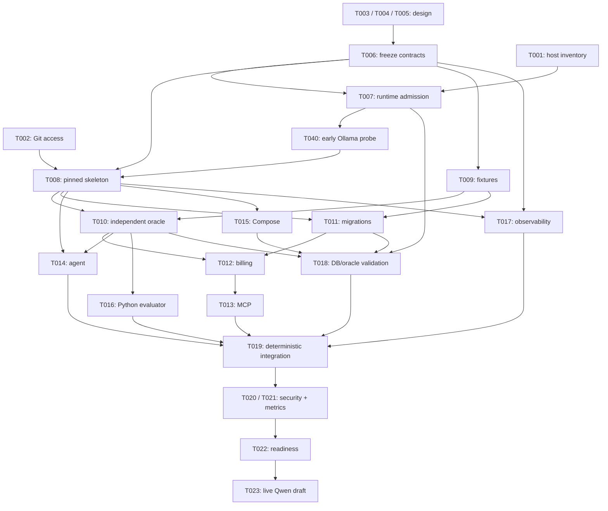

# MCPBench execution plan

Current milestone: T006 static contracts DONE after independent review/testing;
T009 fixtures now IMPLEMENTING. T001 model-store evidence remains BLOCKED. The
active-goal authorization section supersedes historical per-wave approval stops.

This document schedules [TASK_GRAPH.md](TASK_GRAPH.md), which owns IDs, edges,
priorities, statuses and acceptance criteria. The user approved documentation-only T003–T005 execution. Application
implementation, Docker mutations and live Ollama execution require their completed
DAG prerequisites and all relevant admission gates under the active goal. DAG waves express dependencies, not elapsed-time estimates.

## Gates and milestones

| Milestone | Required nodes | Objective completion evidence |
| --- | --- | --- |
| M0: verified host and frozen contracts | T001–T007,T040 | Full host inventory and admission, Git access, reviewed versioned product/evaluation/security contracts; no unresolved runtime assumptions masquerade as facts |
| M1: deterministic invoice slice | T008–T021 | Pinned skeleton, fixture/oracle, real PostgreSQL/MCP and scripted agent checks pass; exact draft and idempotency verified; reset fingerprint stable; runtime security/metrics tests pass |
| M2: live invoice slice | T022,T023 | One actual Qwen tool-calling task passes independent database oracle under monitoring; trace/model digest/config recorded; replay creates no duplicate |
| M3: baseline catalog | T024,T025 | Ten executable authorized tools, project/timesheet fixtures and three recorded full-context smoke attempts; failures retained, not reclassified as successes |
| M4: comparable strategies | T026–T032 | Frozen protocol plus full-context/semantic/hybrid/hierarchical adapters satisfy shared contracts, budgets and ACL tests; complete fairness gate |
| M5: controlled campaign | T033,T039,T034 | Validated 10/100/1000 catalogs, admitted pilot, frozen repeat counts/order; all planned attempts recorded with state and config hashes |
| M6: reliability and report | T035–T038 | Scoped fault/concurrency experiments, reproducible analysis, independent reproduction and report tied to immutable evidence |

M0 is incomplete: actual model-storage verification is blocked and machine
contracts/full admission/live probe are unfinished. Git initialization and commit
now work; T003–T005 completed their independently reviewed/tested refresh.
No runtime probe is authorized. M1/M2 are deliberately separate so fake-model
success cannot be presented as live Qwen success. No later milestone can waive a
failed earlier gate. T035 may proceed alongside the campaign after M4; M6 joins it.

## Waves and joins

| Wave | Eligible work after dependencies | Parallelism / join |
| --- | --- | --- |
| W0 | T001, T002, T003, T004, T005 | T002–T005 DONE; Git works, model-store audit T001 remains blocked. O owns host evidence and graph updates. |
| W1 | T006 after design tasks; T009 after T006 | Freeze interfaces before implementation; fixtures can be authored while waiting for host access. |
| W2 | T007, then T040, then T008 | The early probe needs separate runtime approval after admission; resolve pinned dependencies only after probe success; T009 fixture work does not require runtime access. |
| W3 | T010, T011, T015, T017 | Oracle/fixtures, DB migrations, infrastructure and telemetry have disjoint files; cap at available worker slots. Tests authored before billing code. |
| W4 | T012 and T016 after T010; T014 after T010; T018 after its four parents | Domain, evaluator and agent can develop separately against frozen contracts. Actual builds/integration are serialized by O on Node 1. |
| W5 | T013 after T012; then T019 | MCP adapter completes before integration. O alone wires commands, config and telemetry across packages at the join. |
| W6 | T020 and T021, then T022 | Independent read-only security and telemetry verification; fixes return to file owner. Fresh host/model admission before live call. |
| W7 | T023 → T024 → T025 → T026 | Serial live proof, catalog extension, baseline and protocol freeze. No embeddings/index build before baseline evidence. |
| W8 | T027 and T028 | Selector interface and index artifacts can be independent after frozen protocol. |
| W9 | T029, T030, T031 | Three selector implementations in disjoint subpackages; shared interfaces frozen. O integrates dependency changes. |
| W10 | T032 → T033; T035 after T032 | Fairness review joins selectors. Pilot and scoped deterministic faults may be authored in parallel; expensive executions use one resource lease. |
| W11 | T039 → T034; then T036 after T035 too | Controlled campaign serial on Node 1; later concurrency experiment requires its own admission and bounded budget. |
| W12 | T037 → T038 | Recompute results before writing claims; independent reproduction before final completion. |

## Critical dependencies

There is no measured duration estimate, so this is a **dependency bottleneck path**,
not a claimed calendar critical path. The live-slice chain is:

The table in TASK_GRAPH.md is authoritative for all edges; the figure groups the
parallel design/review nodes and omits the redundant T005→T015 edge. Neither Git
nor host access blocks useful design. Both block a credible live slice. After
T023 the main chain is T024→T025→T026, joining T027/T028 at the three selectors,
then T032→T033→T039→T034. T040 now additionally gates T008. Reporting additionally waits for the fault and concurrency
branch T035→T036 before T037→T038.

## Delegation and exclusive file ownership

Role procedures: [orchestrator](../agents/orchestrator.md),
[implementer](../agents/implementer.md), [reviewer](../agents/reviewer.md) and
[tester](../agents/tester.md). These are instruction files, not running workers.

The T003–T005 documentation assignments are approved; remaining coding-agent
assignments activate only after dependency, access and user authorization gates pass. O creates a compact `state/task-context/<ID>.md` before dispatch:
read-first files, frozen contracts, allowed write paths, forbidden paths, validation
commands and expected handoff. O reserves paths in `state/agents/<ID>.md`; these
state files are now created for T003–T005. While Git is blocked, no application coding or worktrees are dispatched.
Documentation-only T003–T005 assignments are explicitly allowed with exclusive
writable files, content-hash candidates and independent review/testing. No Git
commit/merge or host/runtime validation is implied. This exception allows no
Docker operations, dependency installation or live Ollama call.

| Lane / tasks | Exclusive write surface | Review / testing responsibility |
| --- | --- | --- |
| C: T003,T006,T026,T038 | T003: docs/PROJECT_CONTEXT.md, docs/ARCHITECTURE.md; T006: contracts/; later protocol/report paths assigned separately | R checks product/contract fidelity; V checks fixture/schema completeness |
| E: T004,T009,T010,T016,T025,T037 | docs/EVALUATION_PLAN.md; eval/fixtures/, eval/grading/, eval/reset/, eval/runner/; analysis/ at T037 | R checks grading leakage and denominator rules; V adversarial wrong-state/reset tests |
| C,E: T039 | docs/benchmark/PREREGISTRATION.md; one designated writer, other role reviews | R verifies preregistration before held-out access; V validates immutable config/count references |
| I: T005,T015,T017,T028,T035 | docs/SECURITY_RESOURCE_CONTRACT.md; compose.yaml, containers/; observability/; catalog/; tests/reliability/ in sequence | R checks boundaries/resource scope; V config, redaction and fault tests |
| D: T011,T012 | db/ then internal/billing/, internal/store/ | R checks transactions/money/isolation; V independent DB integration cases |
| M: T013 | cmd/billing-mcp/, internal/mcp/ | R checks MCP lifecycle/schema/security; V real MCP protocol tests |
| A: T014,T027,T029–T031 | cmd/agent/, internal/agent/, internal/ollama/; internal/retrieval/ | R checks model transcript/budgets; V scripted and fairness checks |
| O: T008,T018,T019,T022,T023,T034,T036 | Shared go.mod/go.sum, Python manifests/locks, root commands, integration wiring and tests/integration/; task/state/plan files | R reviews joined candidate; V runs admitted integration/live checks |
| V: T020,T021,T032 | tests/security/, tests/telemetry/, tests/fairness/ | Independent R reviews test validity; O records pass/fail and integrates |

For T029–T031, divide A into separate semantic/hybrid/hierarchical workers owning
`internal/retrieval/semantic/`, `internal/retrieval/hybrid/`, and
`internal/retrieval/hierarchical/`. None may edit the parent interface, catalog or
locks. Submit requested dependency changes to O for serialized integration.
T024 spans DB/MCP surfaces: use a single implementer or sequential handoffs; it is
not safe for overlapping workers to extend those modules simultaneously.

Implementers own adjacent unit tests. V's independently authored tests use the
separate surfaces above; R reviews read-only and never patches the same candidate
concurrently. A failed gate returns edits to the owner, then R/V recheck the new
candidate. O serializes all shared doc/manifest changes. At most three workers
plus O; no requirement to fill every slot. Coding may parallelize; costly host
operations require one O-held resource lease, even across separate worktrees.

Once Git works, O provisions one task branch/worktree per independent change.
No worker merges or pushes main. DONE requires acceptance evidence, no open P0/P1,
no unexplained test failures, handoff, and O integration/state update. Until Git
exists, this plan uses the graph as the task index. The role files above now
exist; task/state files are created when dispatch begins. Keep MLB-specific ML
invariants out of MCPBench.

## P0/P1 risk register

P0 blocks exposure, destructive operations or invalid results. P1 blocks the
relevant live/benchmark milestone until measured or mitigated.

| Risk | Level / owner | Mitigation and experiment | Gate |
| --- | --- | --- | --- |
| Unknown existing containers, project/port/volume collisions | P0 / H,I | Authorized read-only inventory + labels/subnets/port map; render owned config before startup; compare existing health before/after | T001,T007,T018 |
| Reset/admin rights leak into benchmark agent | P0 / E,I | Separate evaluator control plane, dedicated benchmark DB/schema, no admin/DB credentials in agent; negative permission tests and post-reset fingerprints | T005,T010,T020 |
| Public port/privileged container/socket exposure | P0 / I,R | Loopback-only MCP, no DB host mapping, no privileged mode/socket mounts, non-root/drop caps; inspect rendered and actual bindings | T015,T020 |
| Invalid grading, stale fixtures, test-set tuning | P0 / E,V | Oracle before billing, adversarial wrong states, versioned reset hash, frozen splits and ranking knobs, retained failed attempts | T004,T010,T018,T026,T032 |
| RAM pressure, swap, thermal/CPU contention | P1 / H,O | 20 GiB admission; 8 GiB reserve; short serial pilot with 2-second sampling and existing stop policy; no driver/cache/swap repair | T007,T022,T033,T036 |
| Ollama identity/tool capability/eviction unknown | P1 / H,A | Exact tag/digest/show/ps metadata first; no service edits or automatic pulls; one live real-call experiment, record failure without substitution | T001,T022,T023 |
| Read-only .git and denied runtime sockets | P1 / H,O | Resolve via authorized host context; do not bypass protections or request privileged benchmark runtime; docs work remains available | T002,T007 |
| Host-network agent can reach other host services | P1 / I,R | Document reduced isolation; endpoints allowlisted by trusted code, no arbitrary URL/shell tool, no listener. Validate denied tool/output URL injection; application allowlists are not OS egress isolation | T005,T015,T020 |
| Unequal budgets, hidden routing/index cost, missing telemetry | P1 / E,V | Count all routing/retries/tokens, separate build/per-task costs, classify incomplete traces, verify metrics with known values, fixed principal/settings | T021,T026,T032 |
| Synthetic scaling creates non-executable tools | P1 / C,I | Catalog validator requires typed executable safe mocks and oracle contracts; explicitly label simulation scope, record overflow rather than truncating | T028,T033 |
| Concurrent state contamination / duplicate writes | P1 / D,E | Separate run schemas/DBs, server tenant/principal checks, atomic unique idempotency record; concurrent duplicate and timeout-after-commit tests | T012,T019,T036 |

Host networking is the simple way to preserve a loopback-only native Ollama
listener. An isolated bridge plus narrowly scoped relay offers better egress
control but adds another component and policy to validate. T005 must record the
choice and residual risk before T006 freezes it; no native Ollama rebinding is
presumed. Resource estimates and model speed remain experimental assumptions.

## Approved first documentation tasks versus blocked tasks

1. **T003 (DONE refresh):** reconcile the existing product/architecture documents with the
   kickoff. Small documentation change only; preserve the research question.
2. **T004 (DONE refresh):** draft the Python evaluator, fixture/reset/oracle and measurement
   contracts against the kickoff, in its separate documentation file.
3. **T005 (DONE refresh):** document security principals, network choices, resource budgets
   and their exact negative tests, in its separate file.

These completed in parallel with disjoint writes and independent review/testing;
their join makes T006 READY, not complete or authorized for dispatch. Shared assumptions are in WAVE1_CONTRACT_ASSUMPTIONS.md; the
orchestrator owns state/context packs. T006 is not included in this approval and
remains incomplete until its actual contracts and acceptance evidence exist. **T001 remains BLOCKED** on the service-account model-storage target;
**T002 is DONE** with working Git, baseline e0ce746 and independent
reviewer/tester evidence. No broader privilege or model-file access is inferred from Docker access.
T007 onward are WAITING on declared prerequisites, not READY merely because RAM
looks sufficient. No builds, downloads, inference or startup occur now. The
user's environment-verification success condition is not yet satisfied.

## Historical graph validation before this wave

The table was checked programmatically for unique IDs, existing dependency IDs,
self edges, cycles and valid priority/status values. Topological levels were
computed from the dependency table. READY tasks have no unfinished prerequisites;
no implementation node is marked complete. A separate read-only reviewer checks
missing semantic prerequisites, concrete acceptance, contract boundaries and
source-spec fidelity. Static DAG validity does not prove runtime readiness or
predict task duration. Record actual review findings and unresolved limitations
in the handoff; never represent a future acceptance test as already passed.

Validation result (2026-11-07): PASS for 39 unique task IDs, all dependency
targets, no self edges/cycles, valid priorities/statuses, local links and task
references; 23 topological levels. READY = T003/T004/T005, externally BLOCKED =
T001/T002. Independent read-only review identified five P1 planning gaps, all
corrected and re-reviewed with no remaining P0/P1 findings. No runtime or
application test was performed.

## Approved documentation wave — 2026-11-07

T003 owns only docs/PROJECT_CONTEXT.md and docs/ARCHITECTURE.md; T004 owns only
docs/EVALUATION_PLAN.md; T005 owns only docs/SECURITY_RESOURCE_CONTRACT.md. All
paths were checked writable before dispatch. O owns the graph, execution plan,
shared assumptions and state records. Three implementers may draft concurrently.
Freeze each candidate with SHA-256 hashes; pause its author, then independently
review/test the fixed documents. Only after cross-document checks and no open
P0/P1 may O mark these documentation tasks DONE without claiming a Git commit.
T001/T002 stay BLOCKED. T040 is a future runtime probe dependent on T007, with
exclusive artifacts/probes/<probe-id>/ output, one resource lease and separate
user approval. T008 now depends on T040; M0 additionally requires probe success
before application implementation. OpenTelemetry and Jaeger are v2 only.

## Documentation-wave acceptance — 2026-11-07

Independent frozen-v2 reviewer APPROVE and tester PASS cover T003–T005 and
cross-document consistency. Evidence: state/reviews/wave1-reviewer-v2.md and
state/reviews/wave1-tester-v2.md; hashes/snapshots: state/candidates/wave1-frozen-v2.json.
The v1 late-commit/oracle P1 and prose P2s were repaired and rechecked. V2 preserves
the immutable original oracle, separately bounded non-repair replay and final
settlement before cleanup. No open P0/P1 documentation finding remains.

O accepted the documents into this workspace using the approved exception; Git
metadata remains untouched/read-only and no commit or merge is claimed. Status-only
DAG/plan integration follows the frozen-candidate checks. T006 is READY but needs
next-wave approval and its own schema/review/tests before DONE. T001/T002 remain
BLOCKED; T007/T040 and application work remain WAITING and unapproved.

## Permission refresh execution wave — 2026-11-07

This section supersedes old access/status statements above. Docker/Ollama metadata
and Git writes now work; T001 is narrowly BLOCKED on the actual model-storage
filesystem, not sockets. T002 baseline e0ce746 is awaiting independent validation.
T003–T005 are reopened for bounded parallel documentation refresh, preserving their
prior contracts and v2 evidence. They have no host/runtime prerequisite, so this
wave does not waive T001/T007/T040. No application work or live probe is authorized.

O owns NODE1_AUDIT, DAG, execution/state/assumption records and Git integration.
Normal task branches/worktrees replace the earlier blocked-Git exception. Each
implementer changes only the same exclusive source paths; candidate commits freeze
before read-only reviewer/tester checks. O cherry-picks only approved candidates.
Known host baseline: Immich ML unhealthy, NVIDIA driver/library mismatch; preserve
both. JSONL-only v1; OpenTelemetry/Jaeger v2. Recalculate all statuses after review.

## Accepted access refresh and genuinely ready work

T002 and T003–T005 passed independent review/testing and are integrated normally
on main. T006 alone is READY for contract specification/schema work; it has not
been dispatched here. T001 is narrowly BLOCKED on the real model-storage path and
filesystem/free-space evidence. Native Ollama metadata and normal Docker/Git
access do not remove that service-account permission boundary.

Next recommended wave: authorized service-account storage verification for T001
in parallel with T006 machine-readable contract freeze (exclusive contracts/).
After T006 is actually DONE, T009 fixture work can become READY independently;
T007 additionally requires T001 and fresh admission. T040 follows T007 plus separate
runtime approval; T008 follows T002/T006/T007/T040. No application implementation
task is currently READY. Normal runtime/service behavior remains unmodified.
Evidence: state/reviews/access-refresh-reviewer.md and access-refresh-tester.md.

## Active goal-directed execution

The latest user instruction authorizes routine eligible implementation/test/review/
integration transitions without per-wave approval, including T040 after all admission
prerequisites. This supersedes older "next-wave approval" wording only within the
existing approved architecture and security/resource contracts. Stop for sensitive
security changes, architecture changes, unresolved P0/P1 or genuine blockers.
T006 is the first active task, owned exclusively under contracts/. T001 remains
BLOCKED after fresh read-only Git/Docker/Ollama checks; no sudo or file-permission
workaround is authorized. Static contracts and later T009 fixtures can proceed
without runtime admission; builds/downloads/startup/inference cannot.
