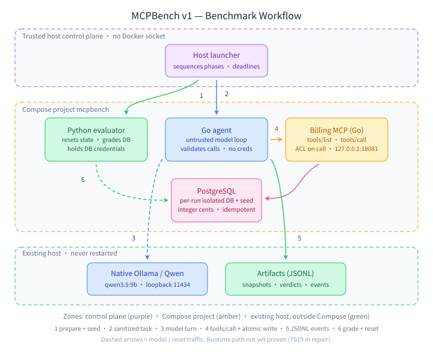

# MCPBench v1 — Benchmark Workflow

A single evaluation attempt flows top to bottom through three trust boundaries:
the trusted host control plane, the `mcpbench` Compose project, and the existing
host services that sit outside Compose.

## The six steps

1. **prepare + seed** — the launcher asks the Python evaluator to spin up an
   isolated per-run database, seed it, and verify the seed fingerprint.
2. **sanitized task** — the launcher hands the Go agent a sanitized task plus a
   run-scoped auth envelope (never placed in the model prompt).
3. **model turn** — the agent converses with Qwen via native Ollama; the model
   proposes a tool call and the agent validates the name and JSON.
4. **tools/call + atomic write** — validated calls reach the billing MCP server,
   which re-checks principal/run on every call and writes the draft invoice
   atomically to the isolated database.
5. **JSONL events** — the agent records correlated JSONL events and its result to
   its narrow artifact paths; output stays untrusted until the evaluator checks it.
6. **grade + reset** — the launcher runs settlement, the evaluator grades the
   database state and answer, then performs a scoped reset.

See [ARCHITECTURE.md](ARCHITECTURE.md) for trust boundaries, resource bounds and
the full terminal-state settlement lifecycle.

> **Status:** contracts, DB/seed, grader, JSONL and static Compose config are
> implemented; the live MCP server, agent invoice path, reset/concurrency
> behavior and container startup are not yet proven at runtime (T019 in repair).
